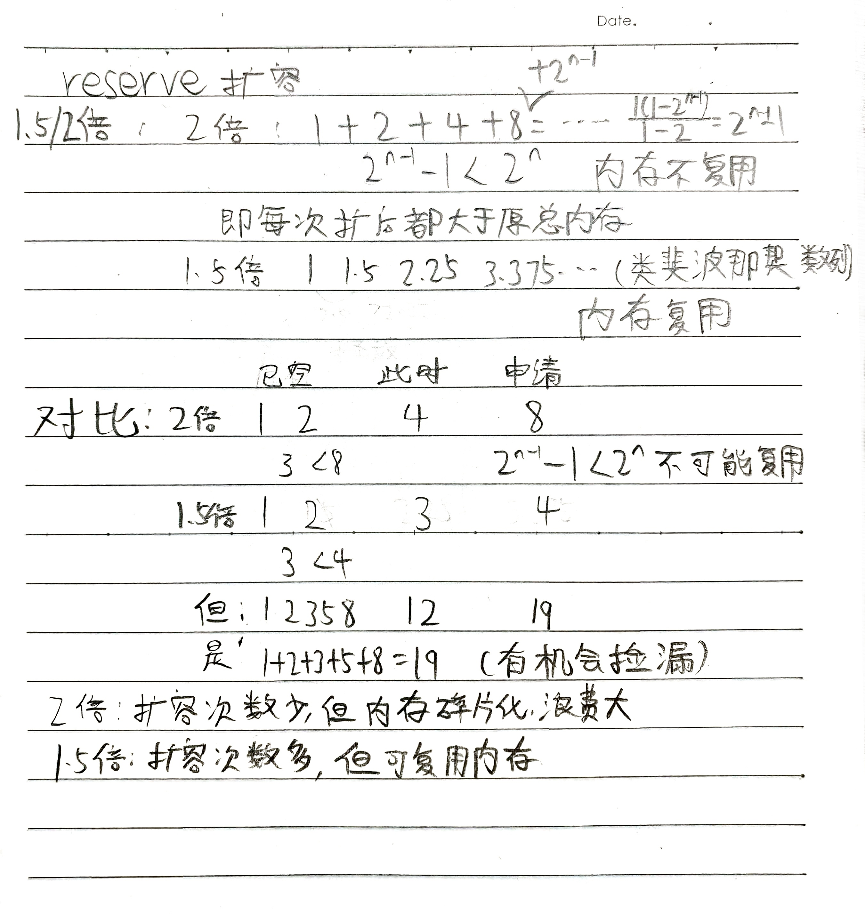

# C++ 核心机制与 Vector 扩容笔记

## 目录
1. [C++ 传参与返回值核心机制对照表](#1-c-传参与返回值核心机制对照表)
2. [1.5倍与2倍扩容策略对比](#2-15倍与2倍扩容策略对比)

---

## 1. C++ 传参与返回值核心机制对照表

### 参数传递 (Passing Parameters)

#### 1. 传递 `T`（按值传递）
- **优点**：代码简洁，函数内部拥有独立副本，可随意修改或移动，完全不影响外部状态；对左值和右值兼容性好。
- **缺点**：传递大型对象时存在性能开销；存在“对象切片（Object Slicing）”风险（基类按值接收会导致派生类特有属性丢失）。
- **构造行为**：传入左值时触发 **拷贝构造（Copy）**；传入右值（临时对象或 `std::move`）时触发 **移动构造（Move）**。

#### 2. 传递 `&T`（左值引用传递）
- **优点**：零拷贝开销，直接操作原始对象；支持在函数内部修改外部传入的数据。
- **缺点**：只能绑定左值（有名字的变量），无法接收右值（如字面量、临时对象）；存在意外修改外部状态的风险。
- **构造行为**：完全不发生构造或拷贝，仅传递内存地址（绑定为别名）。

#### 3. 传递 `&&T`（右值引用传递）
- **优点**：专门用于接收右值，允许函数内部“窃取”即将销毁对象的底层资源（如指针、堆内存），实现极致性能。
- **缺点**：在非模板普通函数中，只能接收右值，普通左值变量无法传入，导致接口极其难用（通常需配合 `const T&` 重载）。
- **构造行为**：不发生拷贝，触发 **移动语义（Move）**，以 O(1) 复杂度直接转移资源所有权。

---

### 返回值 (Return Values)

#### 1. 返回 `T`（按值返回）
- **优点**：返回独立副本，绝对安全，无需担心悬垂引用（Dangling Reference）；完美支持生成新对象的工厂函数或运算符重载。
- **缺点**：传统观念认为返回大对象开销大（但在现代 C++ 中已被编译器优化解决）。
- **构造行为**：现代编译器普遍启用 **RVO/NRVO（返回值优化）**，直接在调用方的内存空间上构造对象，**完全省略**拷贝和移动构造函数的调用。

#### 2. 返回 `&T`（返回左值引用）
- **优点**：零拷贝返回，支持链式操作（如 `v1 = v2 = v3`）或允许调用方直接修改容器内部元素。
- **缺点**：如果返回的是局部变量的引用，函数结束后变量被销毁，会导致 **悬垂引用（Dangling Reference）** 和未定义行为（UB）。
- **构造行为**：完全不发生构造或拷贝，直接返回原始对象的内存地址。

#### 3. 返回 `&&T`（返回右值引用）
- **优点**：明确告诉调用方“这个资源没人要了，你可以直接偷走”，常用于模板的完美转发或返回即将销毁的临时资源。
- **缺点**：在普通业务接口中极少使用，理解成本高，滥用容易导致难以排查的悬垂引用问题。
- **构造行为**：不触发拷贝，触发 **移动语义（Move）**，允许调用方直接窃取底层资源。

---

## 2. 1.5倍与2倍扩容策略对比

**核心结论**：2倍扩容空间换时间（扩容次数少，但内存碎片多）；1.5倍扩容时间换空间（扩容次数多，但能复用内存，避免碎片）。

详细的内存序列推演与底层复用机制，见下方图片说明：

