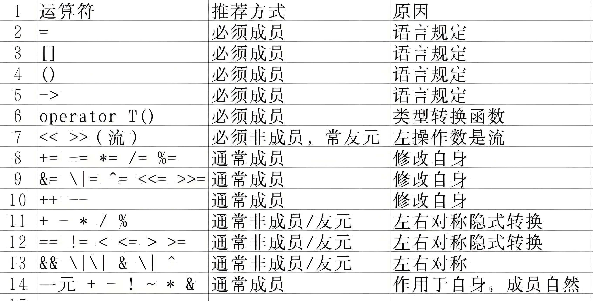

<a name="top"></a >
# 🧠 C++ 拷贝构造与对象生命周期核心笔记

## 🗺️ 思维导图式目录

- **[1. 拷贝构造基础](#sec1)**
  - [1.1 是什么与何时调用](#sec1-1)
  - [1.2 为什么参数必须是 `const 类名&`](#sec1-2)
  - [1.3 拷贝构造 vs 拷贝赋值](#sec1-3)
- **[2. 浅拷贝与深拷贝](#sec2)**
  - [2.1 本质区别：纸条与仓库](#sec2-1)
  - [2.2 为什么没指针就不用深拷贝？](#sec2-2)
  - [2.3 浅拷贝的五大祸害](#sec2-3)
- **[3. 构造函数家族规则](#sec3)**
- **[4. 函数传参与返回机制](#sec4)**
  - [4.1 三种传参方式对比](#sec4-1)
  - [4.2 按值返回与 RVO 优化](#sec4-2)
- **[5. 引用传参详解](#sec5)**
  - [5.1 引用的本质：起外号](#sec5-1)
  - [5.2 引用 vs 指针](#sec5-2)
- **[6. 赋值运算符深度剖析](#sec6)**
  - [6.1 典型代码找错与修正](#sec6-1)
  - [6.2 `String&` 中两个 `&` 的含义](#sec6-2)
- **[7. 核心问答与口诀速查](#sec7)**
  - [7.1 追问 Q&A](#sec7-1)
    - [Q1: `int` 与 `int*` 赋值的区别](#q1)
    - [Q2: 函数调用时的构造与析构](#q2)
    - [Q3: 返回无指针的局部对象](#q3)
    - [Q4: 空拷贝构造与默认拷贝](#q4)
    - [Q5: 引用传参的机制](#q5)
    - [Q6: 赋值运算符错误排查](#q6)
    - [Q7: 返回值 `String&` 中两个 `&`](#q7)
  - [7.2 注意总结](#sec7-2)

---

<a name="sec1"></a >
## 1. 拷贝构造基础

<a name="sec1-1"></a >
### 1.1 是什么与何时调用
用**一个已存在的同类型对象**初始化**一个新对象**。
```cpp
类名(const 类名& other);
```
**调用时机：**
1. 用已有对象初始化新对象：`Person b(a);` 或 `Person b = a;`
2. 对象按值传给函数：`void f(Person p); f(a);`
3. 函数按值返回对象（可能被优化）。
4. 往容器里放对象：`v.push_back(a);`

<a name="sec1-2"></a >
### 1.2 为什么参数必须是 `const 类名&`
*   **必须用 `&`（引用）**：如果是值传递 `Person(Person other)`，调用拷贝构造时又要拷贝实参，导致**无限递归**爆栈。
*   **必须用 `const`**：为了能接收 `const` 对象和临时对象，且保证拷贝过程中不修改原对象。

<a name="sec1-3"></a >
### 1.3 拷贝构造 vs 拷贝赋值
*   `Person b(a);` / `Person c = a;` → **拷贝构造**（对象刚出生）。
*   `b = a;` → **拷贝赋值**（对象已存在，换内容）。
*   *关键：看对象是不是“刚出生”。*

[⬆️ 返回顶部](#top)

---

<a name="sec2"></a >
## 2. 浅拷贝与深拷贝

<a name="sec2-1"></a >
### 2.1 本质区别：纸条与仓库
*   **浅拷贝（默认）**：只复制指针（地址纸条），两个对象指向同一块内存（合租仓库）。
*   **深拷贝（手写）**：重新分配内存（另租仓库），把内容复制过去（逐件搬货）。

<a name="sec2-2"></a >
### 2.2 为什么没指针就不用深拷贝？
因为没有指针（如`int`, `std::string`, `std::vector`），复制就是**真复制**，两份数据完全独立，销毁时互不干扰。有了指针，默认拷贝构造函数的复制方法只复制指针，两个指针指向同一块内存，可能双重释放。
> **注意**：`std::string` 等标准库类型内部已经处理好了指针和深拷贝，对外表现得像值一样安全。

<a name="sec2-3"></a >
### 2.3 浅拷贝的五大祸害
1.  **重复释放**：两个对象 `delete` 同一块内存，程序崩溃（`double free`）。
2.  **互相干扰**：改 A 的数据，B 也跟着变。
3.  **悬空指针**：A 释放了内存，B 还拿着旧地址去访问。
4.  **容器坑**：`push_back` 放进容器的和外面的联动。
5.  **传参假象**：函数内改值传递的参数，居然把外面的原件改了。

[⬆️ 返回顶部](#top)

---

<a name="sec3"></a >
## 3. 构造函数规则
### 编译器赠送默认**1.构造函数，2.析构函数，3.拷贝构造函数**各一。
*   一旦写了**任何**构造函数（包括拷贝构造）：**默认构造失效**。
*   所以：写了深拷贝构造，如果还想用 `类名 a;`，必须手动补上默认构造。

[⬆️ 返回顶部](#top)

---

<a name="sec4"></a >
## 4. 函数传参与返回机制

<a name="sec4-1"></a >
### 4.1 三种传参方式对比
| 写法 | 复印吗？ | 能改原件吗？ | 适合场景 |
| :--- | :--- | :--- | :--- |
| `f(Person p)` | 复印（调拷贝构造）| 不能（改的是复印件）| 小对象 / 需要修改副本 |
| `f(Person& p)` | 不复印 | **能改** | 想修改外部原件 |
| `f(const Person& p)` | 不复印 | 不能（编译器拦截）| **只读首选**，大对象首选 |

<a name="sec4-2"></a >
### 4.2 按值返回与 RVO 优化
*   **理论上**：返回局部变量会调用拷贝构造（或移动构造）。
*   **实际上**：现代编译器有 **RVO（返回值优化）** 和 **NRVO**，直接在调用处构造对象，省掉拷贝。
*   **C++17 起**：返回临时对象（如 `return Person();`）的拷贝省略是**强制**的。
*   **避坑**：千万别写 `return std::move(t);`，这会阻止 NRVO 优化！

[⬆️ 返回顶部](#top)

---

<a name="sec5"></a >
## 5. 引用传参详解

<a name="sec5-1"></a >
### 5.1 引用的本质：起外号
*   引用就是原件的另一个名字，修改引用就是修改原件。
*   **三条铁律**：必须初始化、终身不能换绑（`r = b` 是赋值不是换绑）、不占独立内存。

<a name="sec5-2"></a >
### 5.2 引用 vs 指针
*   **指针**：装地址的盒子。可以为空（`nullptr`），可以换指向。
*   **引用**：人本身的小名。不能为空，不能换绑，用起来像普通变量。

[⬆️ 返回顶部](#top)

---

<a name="sec6"></a >
## 6. 赋值运算符深度剖析

<a name="sec6-1"></a >
### 6.1 典型代码找错与修正(#A3)
**错误代码：**
```cpp
String& operator=(const String& other) {
    data_ = new char[other.size_ + 1]; // 错误1：没释放旧内存，内存泄漏
    strcpy(data_, other.data_);        // 错误2：如果自赋值，data_和other.data_是同块内存，拷贝出垃圾
    size_ = other.size_;
    return *this;
}
```
**正确写法：**
```cpp
String& operator=(const String& other) {
    if (this == &other) return *this;            // 1. 自赋值检查
    
    char* newData = new char[other.size_ + 1];   // 2. 先备新内存（异常安全）
    strcpy(newData, other.data_);
    size_ = other.size_;
    
    delete[] data_;                              // 3. 释放旧内存
    data_ = newData;                             // 4. 接管新内存
    return *this;
}
```

<a name="sec6-2"></a >
### 6.2 `String&` 中两个 `&` 的含义
```cpp
String& operator=(const String& other)
```
*   **返回值 `String&`**：返回引用（返回 `*this` 当前对象本身）。为了不拷贝，且支持 `a = b = c` 链式赋值。
*   **参数 `const String&`**：按引用传递，不拷贝实参。

[⬆️ 返回顶部](#top)

---

<a name="sec7"></a >
## 7. 核心问答与口诀速查

<a name="sec7-1"></a >
### 7.1 灵魂追问 Q&A

<a name="q1"></a >
**Q1：`int` 可以直接赋值，为什么 `int*` 不能直接赋值？**
> **A**：`int` 装的是数字，复制就是真复制；`int*` 装的是门牌号（地址），复制门牌号会导致两个人合租一个仓库，清理时会出人命（重复释放）。

<a name="q2"></a >
**Q2：函数调用对象时，构造和析构怎么发生？**
> **A**：按值传参像“复印”，函数结束复印件被销毁（析构），原件不受影响；引用传参是“递原件”，不产生拷贝。谁造的谁负责死，造得越晚，死得越早。

<a name="q3"></a >
**Q3：返回没有指针的局部对象，会调用拷贝构造吗？**
> **A**：理论上会，但现代编译器大多会用 RVO 省掉。因为没指针，就算发生拷贝也是安全的浅拷贝。

<a name="q4"></a >
**Q4：空拷贝构造和默认拷贝构造一样吗？**
> **A**：不一样。空拷贝构造是“什么都不做”（垃圾值），默认拷贝构造是“逐成员复制”。想要默认行为请写 `= default`。

<a name="q5"></a >
**Q5：引用传参是怎么回事？**
> **A**：引用就是给原件起个外号。传参时不复印，直接把原件递过去。加 `const` 就是“只许看，不许改”，这也是大对象传参的首选。

<a name="q6"></a >
**Q6：赋值运算符中为什么一定要写 `if (this == &other)`？**
> **A**：防止自赋值（`a = a`）。如果不检查，先把旧内存释放了，再去读旧内存的内容，就会读到垃圾，甚至崩溃。<a name="A3"></a >

<a name="q7"></a >
**Q7：`String& operator=` 里的 `&` 是干嘛的？**
> **A**：返回值加 `&` 是为了不拷贝、支持连续赋值（`a = b = c`）；参数加 `&` 是为了不拷贝实参。

[⬆️ 返回顶部](#top)

<a name="sec7-2"></a >
### 7.2 注意总结
*   **总纲**：有指针，手写深拷贝；没指针，不用管。
*   **动作**：传值复印，引用递原件，`const&` 贴封条（只看不改）。
*   **深浅拷贝**：浅拷贝抄门牌，深拷贝另租房。
*   **规则**：自己写了任何构造，编译器就收回默认构造。要哪个，自己补哪个。
*   **返回**：按值返回随便写（编译器会优化），返回局部引用是地雷。

---
